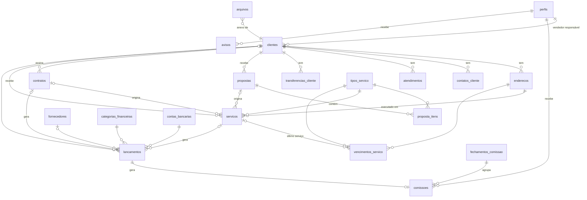

# Plano do Sistema de Gestão — Eco Ambiental SC

> Documento de referência do projeto. Toda sessão de trabalho começa relendo este arquivo.
> Status: **aprovado em 28/10/2026** · Fases 0, 1 e 2 prontas (no projeto dev) · Próxima: Fase 3 (Propostas)

---

## 1. Resumo

Sistema interno, usado no navegador (computador e celular), para a unidade de Santa Catarina da
Eco Ambiental SC. Ele substitui a planilha `Financeiro_Eco_Ambiental_SC.xlsx` e junta num lugar só
clientes, propostas, serviços realizados, vencimentos, financeiro e avisos.

- **Uma empresa, um CNPJ.** A sede do RS fica fora deste sistema.
- **Volume esperado no início:** de 20 a 30 clientes novos por mês. É pouco, e cabe com folga nos planos gratuitos.
- **Prioridade:** primeiro o uso do **administrativo/financeiro**. Os perfis de vendedor e de
  recepção vêm depois, mas o banco já nasce preparado para eles.
- **Técnicos de campo** não usam o sistema por enquanto.

---

## 2. O que aprendemos com a planilha atual

A planilha tem 4 abas: Painel, Lançamentos, Configurações e Resumo Mensal.

| O que a planilha já faz bem (vamos manter)                                   | O que o sistema vai melhorar                                        |
|------------------------------------------------------------------------------|---------------------------------------------------------------------|
| Três datas por lançamento: **competência**, **vencimento** e **pagamento**   | "Cliente / Fornecedor" é texto livre; no sistema vira um cadastro   |
| Só **Realizado** altera o saldo; Pendente e Agendado entram só na projeção   | Categorias de receita e despesa misturadas numa lista só            |
| "Vencido" é **calculado** (vencimento passado e não realizado)               | Um saldo inicial só, mas o lançamento tem "Conta / Banco"           |
| Duas visões: faturamento (competência) e fluxo de caixa (data do pagamento) | Limite de 300 linhas, ID manual, sem registro de quem alterou       |

**Status dos lançamentos** (confirmado com você):

- **Pendente:** ainda não foi pago nem agendado. Alguém precisa agir no dia.
- **Agendado:** já está programado no banco (Pix agendado, débito automático).
- **Realizado:** o dinheiro entrou ou saiu. Só esse status altera o saldo.
- **Cancelado:** não vale mais. O lançamento nunca é apagado.
- **Atrasado** não é um status digitado. O sistema calcula: o vencimento passou e o lançamento não está
  Realizado nem Cancelado. É isso que gera o aviso de cobrança.

As categorias da planilha viram os dados iniciais:

- **Receitas:** Serviços prestados, Contrato recorrente, Outras receitas.
- **Despesas:** Folha / Pró-labore, Combustível, Descarte de resíduos, Fornecedores, Impostos e taxas,
  Aluguel, Energia / Água / Internet, Manutenção, Equipamentos, Marketing, Contabilidade, Outras despesas.

As formas de pagamento também vêm da planilha: PIX, Boleto, Transferência, Cartão, Dinheiro,
Débito automático e Outro.

---

## 3. Tecnologia (stack) e por quê

| Parte                | Escolha                                   | Por que, em palavras simples                                                                                      |
|----------------------|-------------------------------------------|-------------------------------------------------------------------------------------------------------------------|
| Banco, login, arquivos | **Supabase** (PostgreSQL)               | Entrega banco de dados, login, armazenamento de arquivos e permissões prontos. O plano gratuito atende o início.   |
| Permissões           | **RLS** (Row Level Security) do PostgreSQL | O **próprio banco** decide quais linhas cada usuário pode ver. Mesmo que alguém mexa na tela, o banco não entrega o dado. |
| Tarefas diárias      | **pg_cron** (dentro do Supabase)           | Roda todo dia de madrugada para marcar atrasos e criar avisos, sem precisar de outro servidor.                     |
| Tela (front-end)     | **React + TypeScript + Vite**              | React é o mais usado no mercado, o que é bom para o portfólio. TypeScript avisa erros antes de rodar. Vite deixa o desenvolvimento rápido. |
| Visual               | **Tailwind CSS** + componentes próprios (pasta `src/components/ui`) | Monta telas responsivas com as cores da empresa. Os componentes são poucos e simples, escritos por nós, para você entender cada linha. |
| Formulários          | **React Hook Form + Zod**                  | Valida CPF/CNPJ, campos obrigatórios e valores. Os erros aparecem em português.                                   |
| Dados na tela        | **TanStack Query**                         | Busca os dados do Supabase, guarda em memória e atualiza a tela sozinho depois de salvar.                          |
| Celular              | **PWA**                                    | Dá para "instalar" o sistema na tela inicial do celular, como um aplicativo.                                      |
| Hospedagem           | **Netlify**                                | Você já usa no site. É gratuita, publica a cada `git push` e já vem com HTTPS.                                    |
| Testes               | **Vitest** + testes de permissão em SQL    | Garantem que regras importantes (cálculo de vencimento, dia útil, permissões) não quebram sem ninguém perceber.   |
| Código               | **GitHub** + VS Code                       | Você já usa os dois.                                                                                               |

**Alternativas que descartei:**

- **Next.js:** precisaria de um servidor rodando. Como o Supabase já faz o papel de servidor
  (login, regras, permissões), um site estático na Netlify basta e é mais simples.
- **Firebase:** o banco não é relacional. Este sistema é cheio de relações
  (cliente → endereço → serviço → vencimento → lançamento), e o PostgreSQL lida melhor com isso.
- **Backend próprio (Node/Express):** mais código, mais coisa para manter e mais custo.

**Dois projetos no Supabase**, ambos gratuitos:

- `eco-gestao-dev`: para testar à vontade.
- `eco-gestao-prod`: só com os dados reais.

As mudanças no banco ficam em arquivos `.sql` versionados no Git (as *migrations*) e são aplicadas com
a Supabase CLI. Assim nada é feito "na mão" no painel, e qualquer pessoa consegue recriar o banco.
Os dois projetos ficam na região **São Paulo**, por proximidade e por boa prática de LGPD.

### Custos

| Item                              | Custo inicial | Limite gratuito e quando pode precisar pagar                                                                 |
|-----------------------------------|---------------|-----------------------------------------------------------------------------------------------------------------|
| Supabase Free                     | R$ 0          | 500 MB de banco (anos de uso neste volume) e **1 GB de arquivos**. Pausa após 7 dias sem uso, o que não acontece com uso diário. |
| Netlify Free                      | R$ 0          | Bem acima do necessário.                                                                                       |
| Domínio `sistema.ecoambientalsc.com.br` | R$ 0    | É um subdomínio do domínio que você já tem.                                                                    |
| E-mails do sistema (convites, "esqueci a senha") | R$ 0 | O envio padrão do Supabase permite pouquíssimos e-mails por hora. Vamos usar a conta **`adm@ecoambientalsc.com.br`**, que já existe na **KingHost**, como servidor de envio (SMTP), sem criar e-mail novo. |

**Domínio e DNS.** O domínio está registrado no Registro.br, o site `www` está na Netlify e os e-mails
estão na KingHost. Para o sistema basta **um registro novo** no DNS: um `CNAME` de `sistema` apontando
para a Netlify. Os registros dos e-mails (`MX`) e do site **não são tocados**. Os servidores DNS do
domínio são os da **KingHost**, então o `CNAME` é criado no painel da KingHost.

**Cuidado com o `adm@`:** a senha dessa conta fica salva na configuração de envio do Supabase. Se um
dia a senha do `adm@` for trocada, é preciso atualizá-la lá também. Senão os convites e o "esqueci a
senha" param de chegar. Isso vai estar anotado no README.
| GitHub                            | R$ 0          | O backup automático usa o GitHub Actions, que é gratuito.                                                       |

**Atenção às fotos e PDFs.** O limite de 1 GB é o primeiro que vai apertar. As fotos serão
**comprimidas no próprio celular antes do envio**, para cerca de 200–300 KB cada.

- Estimativa: 30 serviços/mês × (6 fotos + certificado + relatório) ≈ 60–80 MB/mês. O espaço dura cerca de 1 ano.
- Quando chegar perto: Supabase Pro (US$ 25/mês, 100 GB) ou mover os arquivos para o
  Cloudflare R2 (10 GB grátis).

---

## 4. Perfis de acesso

O banco já nasce com os 4 perfis. **Na Fase 1 só usaremos Administrador e Financeiro.**

| Perfil            | O que vê e faz                                                                                                      |
|-------------------|---------------------------------------------------------------------------------------------------------------------|
| **Administrador** | Tudo, inclusive criar e desativar usuários e transferir clientes entre vendedores.                                 |
| **Financeiro**    | Tudo o que o administrador vê, mas não gerencia usuários.                                                          |
| **Vendedor**      | Seus clientes, suas propostas, seus serviços, vencimentos e as próprias comissões. **Nada do financeiro dos clientes.** |
| **Recepção**      | Pesquisa e cadastra clientes, vê contatos, histórico de atendimentos e serviços (sem valores) e quem atendeu por último. **Nada financeiro.** |

### Como a segurança funciona

1. **Ninguém cria a própria conta.** O cadastro público fica desligado, e o administrador convida cada
   pessoa por e-mail.
2. **Senhas** ficam guardadas pelo Supabase Auth com criptografia (*hash*). Nem o administrador consegue ver.
3. **Cada tabela tem regras de RLS.** Exemplo: um vendedor que pede todos os clientes recebe do banco só os dele.
4. **Valores escondidos da recepção.** Os campos de valor (por exemplo, o valor de um serviço) não chegam
   ao perfil de recepção. A recepção consulta *views*, que são consultas prontas do banco, e elas não trazem
   essas colunas. A tabela original fica bloqueada para esse perfil.
5. **Arquivos** (propostas, certificados, fotos) ficam num *bucket* privado e são abertos por links
   temporários, que expiram em minutos.
6. **Verificação em duas etapas** (código no celular) é opcional para Administrador e Financeiro.
7. **Testes automatizados de permissão:** para cada perfil, um teste confirma o que ele pode e o que não pode ver.

### LGPD

- Guardamos só os dados necessários para prestar o serviço e cobrar. Essa é a base legal de execução de contrato.
- Toda alteração importante fica registrada: quem fez, quando, e o antes e o depois (seção 5.10).
- Clientes não são apagados, e sim **desativados**. Se um titular pedir exclusão, uma função
  **anonimiza** os dados pessoais e mantém os registros financeiros que a lei obriga a guardar.
- Os backups são criptografados.
- O README terá uma seção explicando esses cuidados.

---

## 5. Modelo do banco de dados (todas as fases)

Convenções:

- Nomes das tabelas e colunas em **português, sem acento**, no formato `snake_case`, para ficarem iguais
  às palavras do negócio.
- Toda tabela tem `id` (identificador gerado sozinho, do tipo UUID), `criado_em`, `criado_por`,
  `atualizado_em` e `atualizado_por`.
- Valores em dinheiro usam `numeric(12,2)`, nunca número com vírgula flutuante, que gera erro de centavos.

### 5.1 Diagrama



### 5.2 Usuários e configuração

**`perfis`**: um registro por usuário, ligado ao login do Supabase (`auth.users`).

| Coluna                   | Tipo / regra                                       |
|--------------------------|----------------------------------------------------|
| id                       | = id do usuário no login                           |
| nome, email, telefone    | texto                                              |
| papel                    | `admin` · `financeiro` · `vendedor` · `recepcao`   |
| comissao_percentual      | % padrão de comissão do vendedor (opcional)        |
| ativo                    | desativar em vez de apagar                         |

**`configuracoes`**: valores ajustáveis sem mexer no código (chave → valor). Exemplos:

- `contrato_dia_util_cobranca = 1`: cobrar no 1º dia útil. Pode virar 5 quando vocês decidirem.
- `aviso_antecedencia_padrao_dias = 30`.
- `comissao_percentual_padrao = 8`.

**`feriados`**: data, descrição e abrangência (nacional, estadual SC ou municipal de **Palhoça**).
Serve para calcular o "n-ésimo dia útil" dos contratos. Os feriados nacionais são carregados todo ano.
Os de SC e de Palhoça são conferidos com a contabilidade e cadastrados numa tela simples.

### 5.3 Clientes (Fase 1)

**`clientes`**

| Coluna                        | Tipo / regra                                                                    |
|-------------------------------|---------------------------------------------------------------------------------|
| tipo_pessoa                   | `PF` ou `PJ`                                                                    |
| nome                          | nome completo (PF) ou razão social (PJ)                                         |
| nome_fantasia                 | só PJ                                                                           |
| cpf_cnpj                      | só números, **único**, com dígito verificador validado                          |
| inscricao_estadual            | opcional                                                                        |
| email, telefone, whatsapp     | texto; telefone guardado só com números para facilitar a busca                  |
| vendedor_responsavel_id       | → `perfis` (fixo, só Admin troca)                                               |
| origem                        | como conheceu (site, indicação, Google, …)                                      |
| observacoes                   | texto                                                                           |
| ativo / anonimizado_em        | desativação e LGPD                                                              |

A **busca rápida** funciona por nome, nome fantasia, CPF/CNPJ ou telefone. Ela ignora acentos e
maiúsculas e tolera pequenos erros de digitação, usando as extensões `unaccent` e `pg_trgm` do PostgreSQL.

**`enderecos`**: cliente_id, apelido (ex.: "Matriz", "Loja Centro"), CEP, logradouro, número,
complemento, bairro, cidade, UF, `principal` (sim/não). O CEP preenche o resto sozinho pela API do ViaCEP.

**`contatos_cliente`**: pessoas de contato do cliente PJ: nome, cargo, telefone, e-mail, principal.

**`atendimentos`**: cada contato com o cliente: cliente_id, usuário que atendeu, data/hora, canal
(telefone, WhatsApp, presencial, e-mail) e resumo. Daqui saem o "último atendimento" e o "quem atendeu
por último", que a recepção usa.

**`transferencias_cliente`**: histórico da troca de vendedor responsável: vendedor anterior, vendedor
novo, motivo e quem fez a troca. Quando um vendedor sai, uma tela permite transferir de uma vez todos
os clientes dele.

### 5.4 Catálogo de serviços

**`tipos_servico`**

| Coluna                         | Tipo / regra                                        |
|--------------------------------|-----------------------------------------------------|
| nome                           | ex.: Limpeza de coifa                               |
| periodicidade_meses_padrao     | ex.: 6 (vazio = serviço sem repetição, ex.: desentupimento) |
| antecedencia_aviso_dias_padrao | ex.: 30                                             |
| tipo_vencimento                | `certificado` (o certificado perde a validade) ou `recomendacao` (a empresa indica refazer) |
| ativo                          |                                                     |

Todos os serviços têm certificado de execução. O que muda é o vencimento: em alguns ele é exigido
(o certificado vence), em outros é só uma recomendação. O texto do aviso ao vendedor muda conforme o caso.

Dados iniciais:

| Serviço                       | Periodicidade padrão | Tipo de vencimento |
|-------------------------------|----------------------|--------------------|
| Controle de pragas            | 3 meses              | certificado        |
| Limpeza de coifa              | 6 meses              | certificado        |
| Limpeza de reservatórios      | 6 meses              | certificado        |
| Sucção de fossa               | 6 meses              | recomendação       |
| Limpeza de caixa de gordura   | 6 meses              | recomendação       |
| Limpeza de placas solares     | 6 meses              | recomendação       |
| Desentupimento                | sem repetição        | —                  |

### 5.5 Propostas (Fase 3)

**`propostas`**

| Coluna                  | Tipo / regra                                                           |
|-------------------------|------------------------------------------------------------------------|
| numero                  | sequencial, gerado sozinho (ex.: 2026-0001)                            |
| cliente_id, endereco_id | endereço opcional                                                      |
| vendedor_id             | → `perfis`                                                             |
| data_envio, validade    | datas                                                                  |
| status                  | `enviada` · `aprovada` · `recusada` · `expirada`                       |
| valor_total             | soma dos itens                                                         |
| prazo_pagamento_dias    | ex.: 15. Usado para gerar a conta a receber quando o serviço for concluído |
| condicao_pagamento      | texto livre (ex.: "50% na aprovação, 50% na conclusão")                |
| motivo_recusa           | quando recusada                                                        |

**`proposta_itens`**: proposta_id, tipo_servico_id, descrição, quantidade, valor_unitario,
periodicidade_meses (quando a proposta combina uma periodicidade diferente da padrão).

### 5.6 Serviços, vencimentos e contratos (Fases 4 e 5)

**`servicos`**: cada serviço executado (ou agendado).

| Coluna                  | Tipo / regra                                                    |
|-------------------------|-----------------------------------------------------------------|
| cliente_id, endereco_id |                                                                 |
| tipo_servico_id         |                                                                 |
| vendedor_id             | vendedor **no momento do serviço** (base da comissão)           |
| proposta_id, contrato_id| de onde veio (opcionais)                                        |
| data_execucao           |                                                                 |
| status                  | `agendado` · `realizado` · `cancelado`                          |
| valor                   | escondido da recepção                                           |
| numero_certificado      | número do certificado de execução                               |
| tecnicos                | texto livre por enquanto (técnicos ainda não usam o sistema)    |
| observacoes             |                                                                 |

**`vencimentos_servico`**: o "quando volta" de cada serviço periódico, **por endereço**.

| Coluna                   | Tipo / regra                                                       |
|--------------------------|--------------------------------------------------------------------|
| cliente_id, endereco_id  |                                                                    |
| tipo_servico_id          | único por (endereço, tipo de serviço)                              |
| periodicidade_meses      | **ajustável por cliente**; começa com o padrão do tipo             |
| antecedencia_aviso_dias  | idem                                                               |
| ultimo_servico_id        | → `servicos`                                                       |
| proxima_data             | calculada sozinha: data do último serviço + periodicidade          |
| ativo                    | desligar quando o cliente não quer mais                            |

Quando um serviço é marcado como **realizado**, uma regra do banco (*trigger*) atualiza a `proxima_data`.
O vendedor responsável recebe o aviso X dias antes, para fazer o follow-up.

**`contratos`**: serviços recorrentes com mensalidade fixa.

| Coluna                  | Tipo / regra                                                       |
|-------------------------|--------------------------------------------------------------------|
| cliente_id, endereco_id |                                                                    |
| vendedor_id, proposta_id|                                                                    |
| descricao               |                                                                    |
| valor_mensal            |                                                                    |
| dia_util_cobranca       | vazio = usa a configuração geral (hoje 1º dia útil)                |
| categoria_id, conta_bancaria_id | para o lançamento gerado                                   |
| data_inicio, data_fim   |                                                                    |
| status                  | `ativo` · `suspenso` · `encerrado`                                 |

Todo mês o sistema cria sozinho o lançamento **a receber** de cada contrato ativo, com vencimento no
n-ésimo dia útil. A conta pula fins de semana e os feriados da tabela.

### 5.7 Financeiro (Fase 2)

**`contas_bancarias`**: nome, banco, tipo (corrente, poupança, caixa), saldo_inicial,
data_saldo_inicial, ativo.

**`categorias_financeiras`**: nome, tipo (`receita` ou `despesa`), ativo.

**`fornecedores`**: nome, CPF/CNPJ, telefone, e-mail, observações, ativo.

**`lancamentos`**: o coração do financeiro, equivalente à aba Lançamentos.

| Coluna                      | Tipo / regra                                                             |
|-----------------------------|--------------------------------------------------------------------------|
| tipo                        | `entrada` · `saida`                                                      |
| descricao                   |                                                                          |
| cliente_id **ou** fornecedor_id | cadastro, não texto livre                                            |
| categoria_id                |                                                                          |
| conta_bancaria_id           |                                                                          |
| competencia                 | mês de referência (faturamento)                                          |
| vencimento                  | data prevista                                                            |
| data_pagamento              | data efetiva (fluxo de caixa)                                            |
| valor                       | valor previsto                                                           |
| valor_pago                  | valor que realmente entrou ou saiu (juros, desconto)                     |
| status                      | `pendente` · `agendado` · `realizado` · `cancelado`                      |
| forma_pagamento             | PIX, Boleto, Transferência, Cartão, Dinheiro, Débito automático, Outro   |
| numero_nota_fiscal          |                                                                          |
| parcela_numero, parcela_total, grupo_parcelamento_id | para parcelamentos (ex.: 2 de 3)               |
| servico_id, contrato_id, proposta_id | de onde veio (opcionais)                                       |
| confirmado_por, confirmado_em | quem confirmou que o dinheiro entrou                                   |
| observacoes                 |                                                                          |

Regras:

- Lançamentos **nunca são apagados**, só cancelados.
- Um lançamento Realizado só pode ser alterado pelo Administrador, e tudo fica na auditoria.
- A view `v_lancamentos` acrescenta a coluna calculada `atrasado` (vencimento < hoje e status
  pendente ou agendado). Painel e avisos usam essa view.
- **Painel de fluxo de caixa:** saldo atual por conta, entradas e saídas previstas (próximos 30, 60 e 90 dias),
  atrasados, saldo projetado e resumo mensal por competência e por caixa. São os mesmos números da
  planilha, sem limite de linhas.

**Como funciona a comissão** (definido com você):

- **8% fixos** sobre tudo o que o vendedor vendeu no mês. O percentual fica numa configuração e pode
  ser diferente por vendedor no futuro.
- A comissão **acompanha o recebimento da empresa**. Um contrato de R$ 2.000/mês por 12 meses
  (R$ 24.000) gera 12 comissões de R$ 160 (8% de R$ 2.000), uma por mês, e não R$ 1.920 de uma vez.
- Por isso a comissão nasce de cada **parcela a receber** ligada a uma venda do vendedor, seja um
  serviço avulso, uma parcela de parcelamento ou a mensalidade de um contrato.
- **Não depende do cliente pagar.** Se o cliente atrasa, o vendedor recebe igual, como já acontece na
  unidade do RS. A comissão conta pelo **mês de competência** da parcela.
- **Paga no mês seguinte.** Tudo o que foi vendido (competência) até o último dia de outubro entra
  na comissão paga no início de novembro.
- Se uma parcela for **cancelada** antes de a comissão ser paga, a comissão dela também é cancelada.

**`comissoes`** (Fase 5): uma linha por parcela a receber que gera comissão.

| Coluna                      | Tipo / regra                                                       |
|-----------------------------|--------------------------------------------------------------------|
| vendedor_id                 | o vendedor da venda (do serviço, contrato ou proposta)             |
| lancamento_origem_id        | a parcela a receber do cliente                                     |
| competencia                 | mês da parcela                                                     |
| base, percentual, valor     | ex.: 2.000,00 × 8% = 160,00                                        |
| status                      | `prevista` → `paga` (ou `cancelada`, se a parcela for cancelada antes do pagamento) |
| fechamento_id               | → `fechamentos_comissao`                                           |

**`fechamentos_comissao`**: o "acerto do mês" de cada vendedor. Tem vendedor_id, competência, valor
total e status (`aberto`, `fechado`, `pago`). No início de cada mês, o sistema monta o fechamento do mês
anterior e avisa o financeiro. Quando o fechamento é pago, o sistema cria a **saída** no financeiro
(categoria Folha / Pró-labore).

### 5.8 Arquivos (Fases 3 e 4)

**`arquivos`**: os arquivos ficam no Storage do Supabase, e esta tabela guarda as informações de cada um.

| Coluna                                       | Tipo / regra                                                         |
|----------------------------------------------|----------------------------------------------------------------------|
| caminho_storage, nome_original, tipo_mime, tamanho_bytes |                                                         |
| categoria                                    | `proposta` · `certificado` · `relatorio` · `foto_antes` · `foto_depois` · `comprovante` · `nota_fiscal` · `outro` |
| cliente_id                                   | sempre preenchido (facilita a ficha e as permissões)                 |
| proposta_id / servico_id / lancamento_id     | **exatamente um** preenchido, ou nenhum (arquivo geral do cliente)   |
| enviado_por                                  |                                                                      |

### 5.9 Avisos (Fase 2 em diante)

**`avisos`**

| Coluna                  | Tipo / regra                                                                       |
|-------------------------|------------------------------------------------------------------------------------|
| destinatario_id         | usuário (ex.: vendedor responsável), **ou**                                        |
| papel_destino           | perfil inteiro (ex.: todos do financeiro)                                          |
| tipo                    | `cobranca_atrasada` · `servico_vencendo` · `contrato_cobranca` · `proposta_sem_resposta` · … |
| titulo, mensagem        |                                                                                    |
| lancamento_id / vencimento_servico_id / proposta_id | para abrir o item com um clique                        |
| chave_unica             | impede aviso repetido (ex.: `cobranca:<id>:2026-11-03`)                            |
| lido_em, resolvido_em   |                                                                                    |

Uma tarefa diária no `pg_cron`, às 6h, gera os avisos. **Futuro (Fase 7):** a tabela `envios_aviso`
registra o que foi mandado por WhatsApp ou e-mail.

### 5.10 Auditoria (Fase 1, vale para tudo)

**`auditoria`**: tabela, registro_id, ação (`insert` · `update` · `delete`), dados_antes, dados_depois,
usuario_id, data/hora.

- Uma única regra do banco (*trigger*) serve para todas as tabelas importantes: clientes, lançamentos,
  contratos, serviços, propostas e perfis.
- **Ninguém consegue editar nem apagar a auditoria**, nem o Administrador pela tela.
- Na ficha do cliente e em cada lançamento haverá um botão **"Histórico de alterações"**.

---

## 6. Fases do projeto

Cada fase termina com algo **usável em produção**, revisado com você antes de seguir.
As regras de permissão (RLS) são escritas junto com cada tabela, já com os 4 perfis.

### Fase 0: Preparação (1 sessão)

- Repositório Git e GitHub, estrutura de pastas, Oxlint e Prettier (padronizam o código).
- Projetos Supabase `dev` e `prod` em São Paulo, com o cadastro público desligado.
- Site na Netlify ligado ao GitHub; subdomínio `sistema.ecoambientalsc.com.br` (CNAME no DNS,
  sem mexer nos e-mails).
- `CNAME` `sistema` criado no painel DNS da KingHost.
- Envio de e-mails do Supabase pela conta `adm@ecoambientalsc.com.br` da KingHost (SMTP).
- Layout base: menu lateral no computador, menu inferior no celular, com as cores da empresa.
- Primeira versão do README.

### Fase 1: Login, perfis e clientes ← começamos aqui

- Login, "esqueci minha senha", sair, sessão expirando.
- Tabela `perfis`, com os 4 papéis no banco e só Admin/Financeiro em uso.
- Tela de usuários (Admin): convidar, trocar papel, desativar.
- Clientes PF/PJ com validação de CPF/CNPJ, endereços com busca por CEP, contatos.
- Busca rápida (nome, CPF/CNPJ, telefone), boa no celular.
- Ficha do cliente com dados, endereços, contatos, vendedor responsável e atendimentos. As seções das
  próximas fases aparecem como "em breve".
- Registro de atendimentos e transferência de vendedor responsável.
- Auditoria funcionando.
- **Backup automático diário** a partir daqui, porque já haverá dados reais de clientes.
- Testes: validação de CPF/CNPJ e as regras de RLS de clientes.

### Fase 2: Financeiro

- Contas bancárias, categorias e fornecedores.
- Lançamentos (filtros, parcelamento, número da NF) e confirmação de pagamento/recebimento num clique.
- Atrasados calculados e aviso de cobrança ao financeiro.
- Central de avisos (primeira versão).
- Painel de fluxo de caixa e resumo mensal.
- Situação financeira na ficha do cliente, só para Admin/Financeiro.
- **Sem importação de planilha:** os dados antigos não foram recuperados e eram poucos. Você cadastra
  pelo próprio sistema, a partir das anotações do celular. Por isso o cadastro de lançamento precisa
  ser rápido, inclusive pelo celular, com um botão "salvar e lançar outro".

### Fase 3: Propostas (drive interno)

- Upload de PDF e outros arquivos, com envio pelo celular.
- Proposta com itens, valor, prazo de pagamento e status enviada, aprovada, recusada ou expirada.
- Histórico de propostas na ficha do cliente.
- Aviso de "proposta sem resposta há X dias".

### Fase 4: Serviços realizados e vencimentos

- Registro do serviço com certificado, relatório e fotos de antes e depois (comprimidas no envio).
- Vencimentos por endereço, com periodicidade e antecedência ajustáveis.
- Avisos de "serviço vencendo" para o vendedor responsável.
- **Concluir serviço → criar conta a receber**, já preenchida com o valor e o prazo da proposta.
  O financeiro revisa e confirma.

### Fase 5: Contratos recorrentes e comissões

- Contratos com mensalidade e geração automática do lançamento no n-ésimo dia útil (feriados incluídos).
- Comissões de 8% geradas por parcela a receber (o contrato de 12 meses gera 12 comissões), pela
  competência e sem esperar o cliente pagar. Fechamento mensal por vendedor, pago no mês seguinte,
  que gera a saída no financeiro.

### Fase 6: Liberação para vendedores e recepção

- Telas e menus específicos de cada perfil.
- Revisão completa das permissões, com testes automatizados para cada perfil.
- Criação dos usuários e um treinamento curto.

### Fase 7: Avisos externos e melhorias

- Avisos por e-mail e WhatsApp: WhatsApp Cloud API, que tem custo por mensagem e será avaliado na época.
- Relatórios extras: faturamento por serviço, por vendedor, taxa de aprovação de propostas.

---

## 7. Backup

| O quê                    | Como                                                                                                   | Frequência |
|--------------------------|--------------------------------------------------------------------------------------------------------|------------|
| Banco de dados           | GitHub Actions num **repositório privado separado** roda o `pg_dump`, criptografa e guarda por 90 dias | Diário     |
| Arquivos (fotos, PDFs)   | Script que copia o Storage para o mesmo destino                                                        | Semanal    |
| Cópia fora da nuvem      | Você baixa o backup mais recente e guarda num HD externo ou Google Drive                               | Mensal     |
| Teste de restauração     | Restaurar o backup no projeto `dev` e conferir                                                         | A cada 3 meses |

Nenhum backup fica no repositório público.

---

## 8. Organização do código

```
ecoambientalsc-sistema/
├── PLANO.md                 ← este arquivo
├── README.md                ← apresentação do projeto (portfólio)
├── supabase/
│   ├── migrations/          ← mudanças no banco, em ordem (arquivos .sql)
│   ├── seed.sql             ← dados iniciais (categorias, tipos de serviço, feriados)
│   └── tests/               ← testes de permissão (RLS)
├── src/
│   ├── app/                 ← rotas, layout, menu
│   ├── features/            ← um diretório por módulo: clientes/, financeiro/, propostas/, ...
│   ├── components/          ← componentes visuais reutilizáveis
│   └── lib/                 ← supabase, validação de CPF/CNPJ, datas, dinheiro
├── .github/workflows/       ← verificações automáticas a cada push
└── .env.example             ← modelo das variáveis (sem segredos)
```

Boas práticas que vamos seguir:

- **Segredos fora do Git:** a chave pública (*anon key*) do Supabase fica no `.env`, e a chave secreta
  (*service role*) **nunca** vai para o código do navegador.
- **Commits pequenos**, com mensagem clara em português.
- **Nenhum dado real** no repositório. A planilha (`*.xlsx`) entra no `.gitignore`.
- **README de portfólio:** prints das telas, diagrama do banco, explicação das permissões e da LGPD,
  e como rodar o projeto.

---

## 9. Decisões tomadas com você

- [x] Um CNPJ, só a unidade de SC.
- [x] Prioridade: Administrativo/Financeiro; vendedor e recepção depois.
- [x] Técnicos não usam o sistema por enquanto.
- [x] Vendedor responsável fixo; o Admin escolhe para quem transferir quando um vendedor sai.
- [x] Cliente pode ter vários endereços, e o vencimento conta por endereço.
- [x] Recepção cadastra e pesquisa clientes.
- [x] Propostas com status enviada, aprovada e recusada.
- [x] Serviço concluído gera conta a receber com o prazo da proposta, e o financeiro confirma.
- [x] Contrato recorrente com valor fixo mensal, cobrado no n-ésimo dia útil. O número é configurável
      (hoje 1; talvez 5).
- [x] Periodicidade ajustável por cliente.
- [x] Todos os serviços têm certificado; guardar certificado, relatório e fotos de antes e depois.
- [x] Parcelamento, número da NF e comissão de vendedor entram no sistema.
- [x] Vendedor vê vencimentos de serviço, mas não vê se o cliente pagou.
- [x] Agendado = programado no banco; Pendente = alguém precisa pagar no dia.
- [x] Você tem GitHub e usa VS Code.
- [x] Repositório **público** no GitHub, só com código e sem dados.
- [x] Endereço `sistema.ecoambientalsc.com.br`. Domínio no Registro.br, site na Netlify, e-mails na KingHost.
- [x] Financeiro e Admin veem tudo; só o Admin gerencia usuários.
- [x] Comissão de 8% sobre as vendas do mês, parcelada conforme a empresa recebe (contrato de 12 meses = 12 comissões).
- [x] Unidade em **Palhoça/SC** (feriados municipais).
- [x] Periodicidades: pragas 3 meses; coifa, reservatório, fossa, caixa de gordura e placas solares
      6 meses (fossa, caixa de gordura e placas solares como recomendação).
- [x] Dados antigos não foram recuperados; você cadastra pelo sistema, sem importação.
- [x] E-mails do sistema saem pelo `adm@ecoambientalsc.com.br` (KingHost), sem criar conta nova.
- [x] DNS do domínio na KingHost: o `CNAME` do sistema é criado lá.
- [x] Comissão não depende do cliente pagar; conta pela competência e é paga no mês seguinte.

## 10. Pendências e dúvidas em aberto

- **Projeto `prod` no Supabase:** criar na região **São Paulo** (o `dev` ficou em us-west-2, o que é
  aceitável só para testes) e aplicar as migrations com `npm run db:push`.
- **SMTP do `adm@` (KingHost):** sem ele, o Supabase só envia e-mails (convites, "esqueci a senha")
  para os membros da equipe do projeto Supabase. Configurar antes de convidar vendedores e recepção.
- **Backup diário:** criar o repositório privado e os segredos (docs/BACKUP.md) antes de cadastrar
  clientes reais.
- **Proteção contra senhas vazadas** (Supabase Auth): só existe no plano pago; ativar se migrar para o Pro.

## 11. Decisões tomadas durante a construção

- **Fase 2:** cada conta bancária tem um saldo inicial **com data**; só os pagamentos a partir dessa
  data mexem no saldo, e o resumo mensal só conta a conta a partir desse mês.
- **Fase 2:** parcelas têm a competência no mês do próprio vencimento (base para a comissão parcelada
  da Fase 5). Os centavos que sobram da divisão vão na 1ª parcela.
- **Fase 2:** lançamento confirmado (realizado) só o Administrador altera ou reabre.
- **Fase 2:** os avisos do financeiro são gerados às 6h (pg_cron) e também ao abrir o painel ou a central
  de avisos; resolvem-se sozinhos quando o lançamento é confirmado, cancelado ou adiado.

1. **Feriados de SC e de Palhoça:** você vai conferir a lista com a contabilidade antes da Fase 5.
